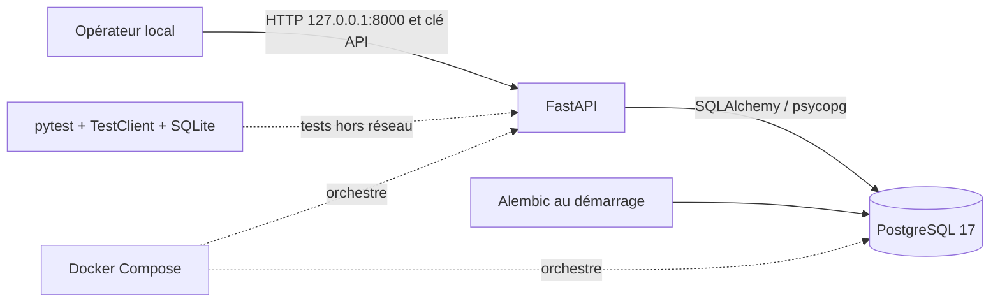
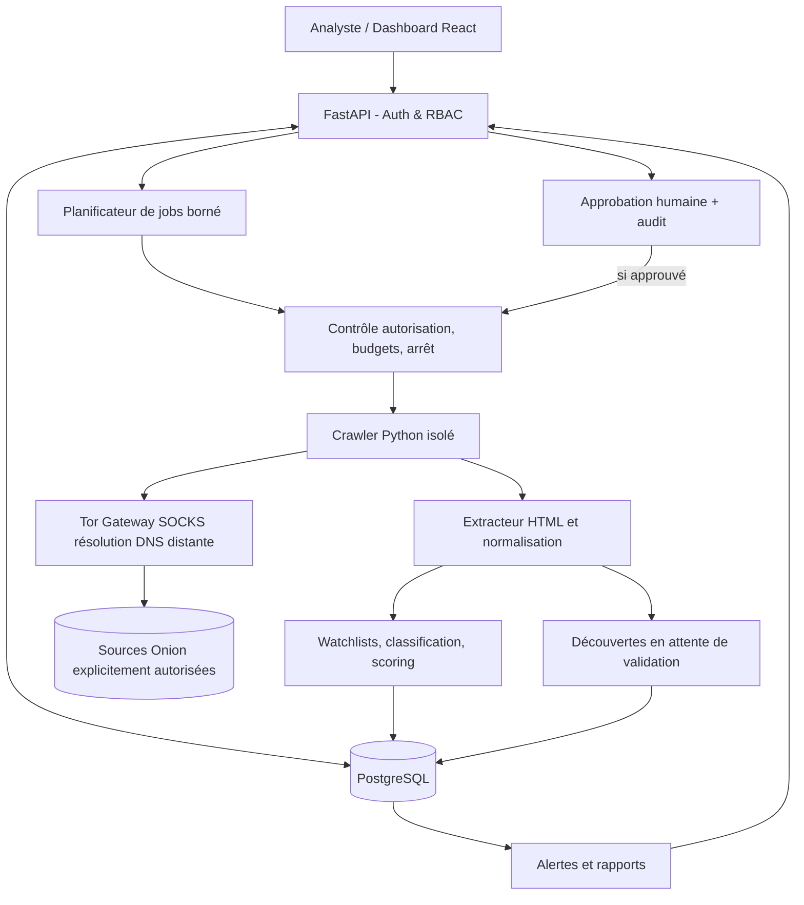

# 01 — Architecture et flux

## Architecture du premier lot, **implémentée**

Le service `db` est joignable uniquement depuis le réseau Docker privé; aucun port PostgreSQL n'est publié. Le service `api` publie son port uniquement sur l'interface loopback. Son conteneur est exécuté sans privilèges, en lecture seule avec `/tmp` éphémère; il n'embarque pas Tor.

### Parcours des requêtes

1. `GET /api/health` : donne l'état du processus sans contacter la base.
2. `GET /api/ready` : effectue `SELECT 1` via SQLAlchemy et renvoie `503` si indisponible.
3. `POST /api/v1/sources` : contrôle `X-API-Key`, exige une confirmation d'autorisation et sa note, valide la structure v3 + checksum, canonicalise l'URL, insère `onion_sources` et `audit_logs` dans une transaction SQL.
4. `GET /api/v1/sources` : demande authentifiée, pagination 1–100, résultat en lecture seule.
5. Aucune de ces requêtes n'effectue de connexion à l'adresse `.onion`.

## Architecture cible du MVP, **non implémentée**

**Sens critique des flux :** le crawler ne reçoit *que* des sources explicitement approuvées. Les liens Onion trouvés sont transformés en candidats conservés **sans être visités**. La future passerelle Tor n'autorise pas de route directe de secours.

## Contrats intermodules prévus

- `SourcePolicy`: `is_allowed(url, job_context) -> décision traçable`; requise avant toute requête HTTP et chaque redirection (redir. désactivées par défaut).
- `FetchResult`: `source_id`, `requested_url`, `status`, `mime`, `size`, `observed_at`, `error_kind`, `body` textuel borné.
- `ExtractedDocument`: `title`, `description`, `text_excerpt`, `headers`, `links`, `fingerprint`, `language`.
- `DiscoveryCandidate`: `canonical_url`, `seen_at`, `source_page`, `anchor_excerpt`, `status=PENDING`.
- `ClassificationResult`: `labels`, `confidence`, `evidence_ids`, `review_status`; séparé de `relevance_score`.
- `ThreatObservation`: `claim_type`, `verification_status`, `provenance`, `observed_at`, `non_sensitive_evidence`.

## Choix justifiés

- **FastAPI + SQLAlchemy sync** : simplifie les tests et les transactions des opérations administratives. Les jobs réseau ne bloqueront pas les requêtes API car ils tourneront hors de ce processus.
- **Alembic** : évolution contrôlée et réversible des tables. Aucune création automatique du schéma par l'API en production.
- **PostgreSQL natif** : transactions, contraintes, indexes et recherche textuelle future, sans moteur additionnel.
- **Pas de broker maintenant** : le besoin de concurrence fiable sera mesuré lors de l'ajout de l'orchestrateur; un traitement interne limité pourra précéder Redis/Celery.
- **Pas de frontend maintenant** : le périmètre initial est testable entièrement en HTTP et OpenAPI.

## Contrôles de sécurité à construire avant tout accès Tor

1. Image du crawler séparée, compte non privilégié, volume et réseau indépendants.
2. Seule sortie réseau autorisée du crawler : passerelle Tor; deny-by-default au niveau firewall/réseau, pas seulement configuration applicative.
3. Proxy SOCKS avec résolution de noms distante; tests vérifiant l'absence de DNS local et de fallback direct.
4. Aucun suivi de liens non validés, aucune redirection vers clearnet, pas d'exécution JavaScript ni de téléchargement binaire.
5. Quotas de taille, requêtes, concurrence, temps et profondeur; délais adaptés aux services Onion.
6. Blocage et revue humaine de catégories hautement sensibles; ne pas collecter d'images, d'archives ou de bases compromises.
7. Journal d'audit des approbations/refus et tableaux d'état sans fausses certitudes.

**Important :** le réseau privé Docker utilisé au lot 0 ne remplace pas une validation de règles egress au moment du lot Tor.
