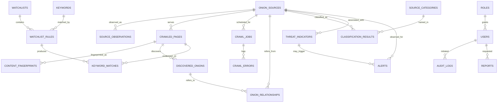

# 02 — Modèle de données PostgreSQL

## Principes

- Identifiants `uuid` pour les entités, UTC en `timestamptz`, chaînes bornées, FK et index selon les requêtes réelles.
- `relevance_score` et `confidence_score` sont des métriques distinctes de 0 à 100 (`CHECK`); la confiance porte sur la justification d'une observation/classification, jamais sur la culpabilité.
- `NOT_CHECKED`, `AVAILABLE`, `UNAVAILABLE`, `ERROR` : état d'accessibilité; `PENDING`, `APPROVED`, `REJECTED`, `QUARANTINED` : validation de découverte.
- Les URL sont canonicalisées avant écriture et dédupliquées en base; les `.onion` sont des racines v3 au lot 0.
- Les relations d'observation portent leur provenance et leur date; aucune accusation n'est déduite d'une simple mention.
- `created_at` et `updated_at` seront présentes pour les tables mutables. Les journaux append-only utilisent `created_at` et ne sont pas éditables.
- Les identifiants et extraits sensibles ne sont pas conservés par défaut; possibilité de conserver le hash, des compteurs et les références documentaires.

## Diagramme entité-relation conceptuel pour le MVP

## Tables prévues et contraintes principales

Les tables suivantes constituent **le modèle cible**, pas la liste des migrations déjà réalisées.

| Table | Champs métier essentiels (en plus de `id` et horodatages) | Liens, contraintes et index |
|---|---|---|
| `users` | `email`, `password_hash`/identité SSO, `active`, `role_id` | Email unique; FK `roles.id`; secrets non exportables |
| `roles` | `code`, `permissions` JSON borné | `code UNIQUE` |
| `onion_sources` | `canonical_url`, `name`, `description`, `category`, `availability_status`, `approved_for_collection`, `collection_enabled`, `authorization_note`, futurs `priority`, `check_interval`, `relevance_score`, `confidence_score` | URL unique; CHECK des scores; index catégorie, statut, dernière observation |
| `source_categories` | `code`, `label`, `sensitive`, `policy_action` | Code unique; taxonomie versionnée |
| `source_observations` | `source_id`, `observed_at`, `status`, `http_code`, `mime`, `response_bytes`, `error_kind` | FK source, index `(source_id, observed_at DESC)` |
| `crawled_pages` | `source_id`, `url`, `title`, `description`, `excerpt_redacted`, `http_code`, `fetched_at`, `mime` | FK source, unique `(source_id, url, fetched_at)`; TTL du contenu |
| `content_fingerprints` | `page_id`, `sha256`, `observed_at`, `change_kind` | FK page, index hash; pas de données brutes |
| `discovered_onions` | `canonical_url`, `origin_page_id`, `first_seen`, `last_seen`, `validation_status`, `reviewer_id`, `reviewed_at`, `review_reason` | URL unique; FK page et reviewer; index validation |
| `onion_relationships` | `source_id`, `candidate_id`, `origin_page_id`, `anchor_excerpt`, `first_seen`, `last_seen`, `count` | FK sources/candidats/pages, index provenance |
| `keywords` | `label`, `pattern`, `match_type`, `enabled` | Règles de longueur/regex bornée; index label |
| `watchlists` | `name`, `owner_id`, `enabled`, `threshold` | FK users, `threshold BETWEEN 0 AND 100` |
| `watchlist_rules` | `watchlist_id`, `keyword_id`, `weight`, `priority` | FK watchlists/keywords; unique paire |
| `keyword_matches` | `rule_id`, `page_id`, `observed_at`, `context_redacted`, `score` | FK règle/page, index règle/date, déduplication |
| `threat_indicators` | `source_id`, `kind`, `subject_ref`, `claim_status`, `verification_status`, `evidence_excerpt_redacted` | FK source; statuts contrôlés; aucune donnée volée |
| `classification_results` | `source_id`, `category_id`, `confidence_score`, `evidence_ids`, `review_state`, `model_version` | FK source/catégorie, index `(source_id, created_at DESC)`, CHECK score |
| `alerts` | `source_id`, `indicator_id`, `kind`, `priority`, `status`, `dedupe_key`, `observed_at` | FK source/indicateur, `dedupe_key UNIQUE`, index statut/date |
| `crawl_jobs` | `source_id`, `status`, `started_at`, `finished_at`, `pages_processed`, `error_count`, `budget_json` | FK source, CHECK compteurs, index statut / date |
| `crawl_errors` | `job_id`, `kind`, `sanitized_message`, `occurred_at` | FK job, index `(job_id, occurred_at)` |
| `reports` | `requested_by`, `period_start`, `period_end`, `format`, `status`, `artifact_ref` | FK user, format contrôlé, export purgé |
| `audit_logs` | `actor`/futur `user_id`, `action`, `entity_type`, `entity_id`, `created_at` | Index entité et date, append-only |

**Attention :** l'implémentation des comptes, autorisations par rôle et des autres tables ci-dessus nécessite des migrations ultérieures. Les captures de contenu ne doivent pas être stockées intégralement avant définition d'une politique de minimisation et de purge.

## Migrations réellement implémentées — révision `0001_bootstrap`

### `onion_sources`

| Colonne | Type PostgreSQL attendu | Règle |
|---|---|---|
| `id` | UUID | PK |
| `canonical_url` | VARCHAR(255) | UNIQUE, NOT NULL |
| `name` | VARCHAR(160) | NOT NULL |
| `description` | TEXT | NOT NULL, défaut vide |
| `category` | VARCHAR(60) | NOT NULL, défaut UNKNOWN |
| `availability_status` | VARCHAR(40) | NOT NULL, défaut NOT_CHECKED |
| `authorization_note` | TEXT | NOT NULL |
| `approved_for_collection` | BOOLEAN | NOT NULL, défaut TRUE (création manuelle uniquement) |
| `collection_enabled` | BOOLEAN | NOT NULL, défaut FALSE |
| `created_at`, `updated_at` | TIMESTAMPTZ | NOT NULL, défaut NOW |

Indexes : `UNIQUE canonical_url`, index `category`. Toute extension des colonnes passe par Alembic.

### `audit_logs`

| Colonne | Type PostgreSQL attendu | Règle |
|---|---|---|
| `id` | UUID | PK |
| `actor`, `action` | VARCHAR(80) | NOT NULL |
| `entity_type` | VARCHAR(60) | NOT NULL |
| `entity_id` | UUID | NOT NULL (référence générique, pas FK directe) |
| `created_at` | TIMESTAMPTZ | NOT NULL, défaut NOW |

Index composite `(entity_type, entity_id)`. L'auteur est pour l'instant `api_key_operator`, car la clé API est partagée. Une attribution nominative nécessite le futur RBAC.

## Rétention et journalisation

- Métadonnées de service : durée à fixer avec le responsable de traitement; correction/suppression traçable.
- Extraits de texte : durée courte, masquage d'entités privées, purge automatique à implémenter.
- Liens découvertes : origine documentée et statut de décision, sans exploration implicite.
- Erreurs : uniquement contexte diagnostique neutralisé, pas de secrets.
- Rapports : versionnés, provenance explicite et politique de suppression.
- Audit : append-only, accès restreint, durée à déterminer; aucune clé API enregistrée.
