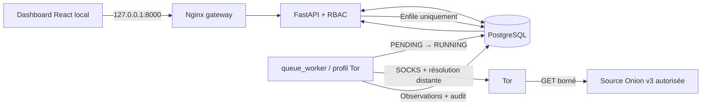

# Architecture et limites de sécurité

*État implémenté — OIP v1.0.0-rc2 (et non plan cible historique)*

## Vue d'ensemble



**Séparation des responsabilités.** FastAPI valide les opérateurs (`VIEWER`, `ANALYST`, `ADMIN`), les approbations et les conflits de jobs, sans lancer Tor ni Docker. Le worker séparé consomme les demandes explicites depuis PostgreSQL. Il revérifie les autorisations au moment de l'exécution. Les liens découverts ne sont ni suivis ni mis automatiquement en collecte.

## Réseaux et conteneurs

| Service | Réseaux Compose | Publication hôte | Rôle |
|---|---|---|---|
| `gateway` | `ingress`, `private` | `127.0.0.1:8000` uniquement | Interface et reverse proxy |
| `api` | `private` interne | Aucune | HTTP, RBAC, audits, transactions |
| `db` | `private` interne | Aucune | PostgreSQL et migrations |
| `tor` | `tor_proxy` interne, `tor_egress` | Aucune | Proxy SOCKS isolé |
| `collector` | `private`, `tor_proxy` internes | Aucune | Consultation ponctuelle CLI |
| `queue_worker` | `private`, `tor_proxy` internes | Aucune | Exécution des jobs déposés par l'UI |
| `tests` | `network_mode: none` | Aucune | Tests backend hors réseau |

Le service `queue_worker` reste **opt-in** sous `--profile tor`. Les conteneurs applicatifs sont non privilégiés et sans capacités ajoutées, avec des contrôles read-only et des limites de ressources. Le proxy Nginx est accessible seulement par l'interface loopback de l'hôte.

**Limite importante :** les tests réseau observent certaines impossibilités de connexion directe ; ils ne prouvent pas formellement l'absence de toutes les fuites (IPv6, comportements d'hôte, règles Docker et DNS futures). Un audit réseau indépendant reste conseillé pour tout déploiement sensible.

## Politique de collecte

- **Périmètre** : adresse racine `.onion` v3 explicitement autorisée ; rejet des chemins, ports personnalisés et hôtes non Onion.
- **Déclenchement** : clic ou appel API **manuel** ; aucun cron, planificateur automatique ou exploration récursive.
- **Transport** : requête HTTP via SOCKS Tor avec résolution distante ; aucun retour direct vers clearnet.
- **Contenu** : HTML/textuel seulement, réponse limitée à **256 Kio**, redirections désactivées, pas de scripts exécutés, médias, archives, fichiers suspects ni identifiants de connexion.
- **Protection en profondeur** : autorisation contrôlée à la création puis au claim ; révocation avant la collecte = refus, révocation pendant = résultat écarté.
- **Stockage** : métadonnées, empreintes, observations, indicateurs prudents, scores explicables et traces d'audit ; pas de conservation des corps HTML bruts.

Les contenus Onion sont **non fiables**. Les catégories/scores CTI ne prouvent ni compromission ni infraction. Toute donnée sensible doit faire l'objet d'une revue humaine et d'une politique de conservation adaptée.

## Machine à états des jobs

```text
  clic autorisé          worker / DB
      │                      │
      ▼                      ▼
   PENDING ───────────────▶ RUNNING ─────▶ COMPLETED
      │                      │
      └── autorisation ──────┴───────────▶ FAILED
          révoquée / incident
```

Une contrainte PostgreSQL interdit deux jobs actifs pour une même source. L'UI actualise le statut approximativement toutes les 4 secondes. **Un job `RUNNING` bloqué après un crash n'est pas automatiquement rejoué.** Après avoir arrêté le worker et confirmé l'absence de job actif depuis au moins 60 minutes, l'administrateur peut utiliser :

```bash
sudo docker compose stop queue_worker
sudo docker compose --profile tor run --rm queue_worker --recover-stale
sudo docker compose --profile tor up -d tor queue_worker
```

Ne pas exécuter `--recover-stale` en parallèle d'un traitement valide.

## Évolution des données

Les migrations `0001_bootstrap` à `0008_manual_queue` sont **nécessaires** pour reconstituer une installation depuis zéro. Ne pas les supprimer sous prétexte de nettoyer l'historique documentaire. La version en base se consulte avec `sudo docker compose exec -T api alembic current` ; l'état attendu est `0008_manual_queue (head)`.

Le modèle utilisé est défini par SQLAlchemy dans `backend/app/models/` et les migrations Alembic, qui sont la **source de vérité**, plutôt que par les anciens schémas théoriques retirés.

## Risques résiduels

1. L'autorisation est une **déclaration de l'opérateur**, non une vérification juridique automatique.
2. La destination réseau Tor est un service externe potentiellement hostile ; l'isolation est testée sur des scénarios précis, pas certifiée.
3. L'authentification utilise des **jetons de possession** : perte du jeton = risque d'accès jusqu'à expiration/révocation. L'UI est locale, sans accès multi-tenant Internet prêt à l'emploi.
4. Les sauvegardes et exports peuvent contenir des URL/observations sensibles ; chiffrement, rétention et contrôle d'accès appartiennent à l'exploitation.
5. Les versions Python/frontend de la RC2 sont bornées/partiellement épinglées ; le lockfile npm généré sur poste doit être versionné, et les audits de vulnérabilités sont **temporels**, non des garanties perpétuelles.
6. Le test Playwright de collecte peut être ignoré pour éviter toute requête Onion ; une recette de bout en bout sur une source autorisée reste à documenter avant un usage plus large.
